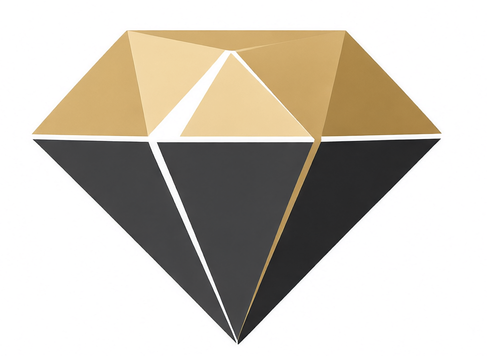

<p align="center">
  
</p>

# Carat - Painless software distribution for Crystal shards

Supports crossplatform install for:

- console applications
- gui applications with your logo


Extends `shard.yml` with a `binaries:` section — **fully compatible with
standard Crystal installs**: `shards install` / `shards build` / shard.lock
keep working untouched (shards simply ignores the extra key).

- **Build and share your Crystal shards like Ruby gems** — a package can be
  a tool you *use right now*, not just a library you require.
- **Prebuilt binaries out of the box** — when a release ships them,
  `carat install` downloads the binary for your platform instead of
  compiling: no local toolchain needed (see
  [Prebuilt binaries](#prebuilt-binaries-release-assets)).
- **System-wide install as a system binary** — `carat install owner/repo`
  puts a ready-to-run release binary into `~/.carat/bin` (on your PATH).
  One command, immediately useful. No manual installs, no PATH pain.
- **Compile flags per target system** — Windows, Linux and Darwin often
  need different (link) flags; `binaries:` in shard.yml declares them
  per OS, so the same shard builds everywhere.
- **Real-world builds** — custom `main:` files, native `prebuild:` steps
  (rake/cmake/make), explicit archives and link flags: GUI and app shards
  install as easily as hello-world CLIs.
- **Project mode too** — `carat install` in a project delegates to
  `shards install` and builds binaries into `./.carat/bin`;
  `carat exec` runs them like `bundle exec`.
- **Desktop apps** — give a binary `launchers: {menu: true, desktop: true}`
  and add `assets:appicon:` (PNG/SVG), and carat ships it as a real GUI
  app: application-menu entry and/or desktop shortcut per platform
  (XDG `.desktop` / Start Menu `.lnk` / macOS `.app`), icon wrapped for
  the platform — no conversion pipeline (see
  [Desktop apps](#desktop-apps-launchers-and-assetsappicon)).
- **Self-hosting** — carat installs and updates itself through carat.
- **Shell autocompletion out of the box** — bash, fish and zsh: `carat exec
  <TAB>` completes your project binaries (see
  [Shell autocompletion](#shell-autocompletion)).

In Ruby, a package can be a tool: `gem install` gives you a working binary
in one command, immediately useful. Crystal shards never had that — a CLI
shard meant `git clone`, `crystal build`, and hand-editing your PATH.
carat fixes it:

```
$ carat install OrelSokolov/hello_binary
$ hello_binary
hello_binary 1.1.0: Hello from a carat-installed shard!
```

One command: the shard is fetched from GitHub, its `binaries:` are built
with `crystal build --release`, and self-contained binaries land in
`~/.carat/bin` — on your PATH, ready to use. No manual installs, no PATH
pain, no "first clone five repos and read the README".

## The idea

A package should bring value the moment it's downloaded. If a shard ships a
binary — a CLI tool, a code generator, a formatter — installing it should be
as simple as installing a gem:

| Ruby                  | Crystal with carat                  |
| --------------------- | ----------------------------------- |
| `gem install rubocop` | `carat install crystal-tools/linter` |
| `rubocop` just works  | `linter` just works                  |

carat treats `binaries:` in `shard.yml` as a first-class delivery format:
the binary **is** the package. Libraries keep working the usual way —
`carat install` inside a project delegates to `shards install`.

## Quick start

```bash
carat install owner/repo        # from GitHub: owner/repo shorthand
carat install name              # bare name → github.com/<name>/<name>
carat install https://github.com/owner/repo.git
carat install git@gitlab.com:owner/repo.git   # any git host (GitLab, Gitea,
                                              # sr.ht, ...), https or ssh
carat install ssh://git@git.example.com/owner/repo.git
carat install ~/code/my-tool    # local checkout
carat install .                 # the shard in the current directory — global
                                 # install while developing it locally
```

Sources are resolved in that order; the built binaries are the same in every
case.

**Private repositories** need no special carat options: authentication is
delegated to `git` itself, exactly like a `shards` `git:` dependency — ssh
keys, a credential helper or an https token all work. For an https repo where
git would prompt for a username/token, carat passes the prompt through to
your terminal.

## Commands

| Command                  | Behavior                                                            |
| ------------------------ | ------------------------------------------------------------------- |
| `carat install <src>`    | Global install: clone → release build → binaries in `~/.carat/bin`. Resolves like shards: the latest release tag when the repo has tags, otherwise the default branch HEAD |
| `carat install head <src>` | Always the default branch HEAD (fresh master, experimental): pinned per commit (`version+git.commit.<sha>`), so `carat update head` follows every push |
| `carat install <src> --version 1.1.0` | Install a specific release tag (like `gem install gem --version`); fails with the list of available versions if the tag is missing |
| `carat install .`        | Global install of the shard in the current dir (local development)  |
| `carat install`          | In a project: delegates to `shards install`, builds `binaries:` into `./.carat/bin` |
| `carat update <src>`     | Update if the remote identity is newer (tag: semver decides; head: any new commit) |
| `carat user remove <name>` | Uninstall a user-scope shard: binaries from `~/.carat/bin`, examples, GUI apps with their launchers, the source store and version pointer |
| `carat system remove <name>` | Same for a `--system` install: binaries from `/usr/local/bin` (`%ProgramFiles%\carat\bin` on Windows); examples, apps and the store are cleaned the same way. Needs root/Administrator |
| `carat update head <src>` | Re-resolve the default branch HEAD and rebuild                     |
| `carat update`          | In a project: delegates to `shards update`, rebuilds `./.carat/bin` |
| `carat dev install`     | Like `install`, but builds with a plain `crystal build` (no `--release`): faster codegen for development iteration |
| `carat dev update`      | Same for `update`                                                   |
| `carat only install`    | Like `install`, but only runs `shards install` — no binary build (drop-in `shards install` compatibility) |
| `carat only update`     | Same for `update` (`shards update` only)                            |
| `carat shards install`  | Synonym of `carat only install`                                     |
| `carat shards update`   | Synonym of `carat only update`                                      |
| `carat exec <cmd> [args]`| Like `bundle exec`: runs `<cmd>` with `./.carat/bin` prepended to PATH |
| `carat self install`     | Install-or-update carat itself from the canonical repo (`OrelSokolov/carat.cr`); `carat self update` is the same thing |
| `carat completion install` | Install shell autocompletion (bash / fish / zsh)                       |

Both `install` and `update` accept:

- `--with-examples` — also build the optional `examples:` section (see below)
- `--build` — skip prebuilt release binaries: always compile from source
  (see [Prebuilt binaries](#prebuilt-binaries-release-assets))
- `--system` — install binaries into the system directory instead of
  `~/.carat/bin`: `/usr/local/bin` on Linux/macOS (on PATH by default),
  `%ProgramFiles%\carat\bin` + the machine PATH on Windows. Requires
  root/Administrator; without the rights carat fails fast — before any
  clone or build — with a clear error. The version store stays in
  `~/.carat/shards`, so `carat update` keeps working.

`install` also accepts `--version <ver>` (space or `=` form): install a
specific release tag instead of the latest — `carat install owner/repo
--version 1.1.0`, like `gem install gem --version`. The tag name is
normalized through semver (`v1.1.0` matches `1.1.0`); if there is no such
tag, carat fails with the list of available versions. Combine with
`--system` as usual, and remove later with `carat user remove <name>` /
`carat system remove <name>`.

## Make your shard instantly installable

Add a `binaries:` section to shard.yml — carat's delivery contract. The
simplest form is a list (entrypoints default to `src/<name>.cr`):

```yaml
binaries:
  - hello_binary
```

The full form covers real-world builds — custom main files, native
prebuild steps, compiler and linker flags that differ per OS:

```yaml
binaries:
  widgets_gallery:
    main: examples/widgets_gallery.cr    # any file, not just src/
    prebuild: rake build:native          # native build step, run in the shard root first
    flags:                               # crystal build flags
      "*": [--something]
      darwin: [-DUSE_METAL=0]
    link_flags:                          # linker flags, per-OS selectors
      "*": [-Llib]
      linux: [lib/libfoo.a]              # explicit archive — ld order safe
      windows: [/LIBPATH:lib]
```

### Shared keys: `all:` and `each:`

In the mapping form two reserved keys control the whole section — no need
to repeat the same spec on every binary:

```yaml
binaries:
  all:                      # ONCE per section, before any binary is built
    prebuild: rake build:native
  each:                     # defaults for EVERY binary (own keys override)
    flags: [-DSOME=1]
  hello: {}                 # gets each:'s flags, all:'s prebuild already ran
  widgets_gallery:
    main: examples/widgets_gallery.cr
  tool:
    flags: [-DOTHER=1]      # own flags win over each:'s
```

- `all:` — the section-wide step: its `prebuild` runs **one time** before
  the section's builds (the shared native step — not once per binary), its
  `flags`/`link_flags` are the base for every binary.
- `each:` — per-binary defaults: `prebuild` runs before **each** binary,
  `flags`/`link_flags` apply to each unless the binary overrides them.
- Precedence: the binary's own keys > `each:` > `all:`. Neither key is a
  binary itself.

Dependencies declared in `dependencies:` are resolved automatically: a
global install runs `shards install` in the stored copy before building,
so shards with dependencies install as smoothly as dep-free ones.
`prebuild:` stays for native build steps (rake/cmake/make), not for
dependency resolution.

Selector resolution follows crosspack's `hosts:` rules: exact OS family
(`linux` / `darwin` / `windows`), then `*` — first hit wins. A plain list
instead of a mapping applies to every OS. Relative paths in `link_flags`
are resolved against the shard root (mold/ld do not open relative
`--link-flags` paths).

Version resolution mirrors `shards`: a `carat install`/`carat update`
picks the **latest release tag** of the repository (annotate your tags:
`git tag v1.2.0 && git push --tags`); untagged repos ride the default
branch HEAD. `carat install head <src>` / `carat update head <src>` always
track fresh master — useful for experimental work-in-progress — with the
install pinned per commit (`version+git.commit.<sha>`, the shard.lock
notation), so updates follow every push even without a version bump.
`carat self` tracks master this way (the canonical repo isn't tagged per
release). Version resolution itself needs no releases page and no install
scripts — and when a release does ship prebuilt binaries, carat uses them
(see [Prebuilt binaries](#prebuilt-binaries-release-assets)).

`shards` ignores the extra `binaries:` key, so the shard stays a perfectly
normal shard — `shards install` / `shards build` keep working (verified
with shards 0.20).

### Optional examples: `examples:`

`examples:` is the same contract as `binaries:` (list or full mapping
form), but for demo/sample binaries. It is **never built by default** —
recursive installs would balloon quickly — only on demand:

```bash
carat install owner/repo --with-examples   # global: binaries in ~/.carat/bin,
                                           # examples in ~/.carat/examples
carat install --with-examples              # project: examples in ./.carat/examples
```

```yaml
examples:
  widgets_gallery:
    main: examples/widgets_gallery.cr
```

Example binaries land in a separate dir (`~/.carat/examples` /
`./.carat/examples`), so they never pollute your PATH.

### Desktop apps: `launchers:` and `assets:appicon:`

A binary with a `launchers:` mapping is a desktop application, not just a
CLI tool — carat gives it desktop presence beyond the PATH entry:

```yaml
assets:
  appicon: assets/icon.png     # or .svg — the app icon, any path in the shard

binaries:
  myapp:
    launchers:
      menu: true               # application menu entry
      desktop: true            # shortcut on the desktop (in addition)
      args: [--no-dir]         # launcher command arguments (see below)
  helper: {}                   # regular CLI binary, business as usual
```

The three launcher flags:

| Flag | Default | Meaning |
| ---- | ------- | ------- |
| `terminal` | `true` | The usual carat install: binary in `~/.carat/bin`, on PATH. `false` moves it off the PATH into its own app dir (`~/.carat/apps/myapp/bin/`) — for pure-GUI apps |
| `menu` | `false` | Entry in the application menu: XDG `.desktop` on Linux, Start Menu shortcut on Windows, `.app` bundle in `~/Applications` on macOS |
| `desktop` | `false` | Shortcut on the user's desktop, **in addition** to the menu entry — not instead of it |

`args:` (optional) adds command arguments to the native launchers —
`Exec=` in the `.desktop`, `Arguments` in the `.lnk`, `CFBundleArguments`
in the bundle's Info.plist. A string is split on whitespace
(`args: --no-dir --theme Dark`), a list carries each element as one
verbatim token (`args: ["--msg", "keep this together"]`). The terminal
binary on PATH gets no arguments — you pass those yourself. Typical use:
launching a GUI editor folderless, when the launcher's cwd (`$HOME`,
often a huge directory) would otherwise become its workspace.

On install, icons land in `~/.carat/apps/myapp/icons/` and the native
launchers are generated for the platform:

| Platform | `menu` | `desktop` | Icon |
| -------- | ------ | --------- | ---- |
| Linux (any distro) | `~/.local/share/applications/myapp.desktop` | `~/Desktop/myapp.desktop` (XDG_DESKTOP_DIR) | PNG/SVG as-is |
| Windows | Start Menu `.lnk` | Desktop `.lnk` | `.ico` built from the PNG |
| macOS | `~/Applications/Myapp.app` | symlink on the Desktop | `.icns` built from the PNG |

Two things keep this simple:

- The icon format is verified by **magic bytes** (marcel.cr port) — PNG or
  SVG only, a mislabeled file fails the install with a clear error.
- **No conversion pipeline**: `.ico` and `.icns` are containers that
  accept a PNG payload as-is (Vista+ / modern macOS), so carat wraps the
  bytes itself; on Linux `.desktop` accepts PNG/SVG paths directly. SVG
  sources work on Linux as-is; on Windows/macOS they need a rasterizer
  carat doesn't ship — the shortcut is created without an icon.

The application knows **nothing** about carat: its read-only assets (if
any) live next to the binary in the app dir — the portable-app
convention, resolved relative to the executable — and writable data
belongs in the platform user dirs (`XDG_DATA_HOME`, `%APPDATA%`), not in
carat's layout. Launchers reference absolute paths, so `carat update`
regenerates them on every version change.

### Build flags from dependencies

A shard's binaries often link C libraries through binding shards. A
**dependency** may declare top-level `flags:` / `link_flags:` in its own
shard.yml (same per-OS selector format), and carat applies them when
building binaries of any shard that depends on it:

```yaml
# lib/some_binding/shard.yml
name: some_binding
version: 1.0.0
flags:
  "*": [-DSOME_BINDING=1]
link_flags:
  linux: [-lsome]
```

Flags are collected recursively from `lib/**/shard.yml` (populated by
`shards install`; in global installs — by a `prebuild:` step), merged
with the binary's own flags and deduplicated (own flags first, order
preserved). The merged list is printed during the build, so what the
compiler actually received is always visible. `shards` ignores these
keys, so the dependency stays a normal shard.

### Prebuilt binaries: release assets

If the repository ships prebuilt binaries on a **GitHub release tag**,
carat downloads them instead of compiling — no local Crystal toolchain
needed:

```
$ carat install owner/tool
Installed prebuilt tool 1.2.0 from tool-1.2.0-linux-x86_64.tar.gz (linux/x86_64)
```

This is pure auto-detection — no keys in shard.yml. On every **tagged**
GitHub install carat looks through the release assets for one matching
your platform, by convention:

```
{name}-{version}-{os}-{arch}.tar.gz | .zip
      os: linux | macos | windows
      arch: x86_64 | arm64 | universal (macos)
```

Matching is tolerant (tokens in any order and case, separators `-_.`):
synonyms `darwin`≈`macos`, `amd64`/`x64`≈`x86_64`, `aarch64`≈`arm64`,
version with or without `v` — or missing altogether. If the author's
CI matrix had a cell for your platform, carat finds its artifact:

```
tool-1.2.0-linux-x86_64.tar.gz   # canonical
tool-darwin-amd64.tar.gz         # synonyms
Tool_1.2.0_x64_Linux.zip         # free form
tool.exe                         # bare Windows binary
```

Safety rails — prebuilt can never break an install:

- Anything wrong — no release, no matching asset, an ambiguous match
  (two equal candidates, e.g. plain and `-bundled` variants), checksum
  mismatch, archive without the expected binary — carat prints one line
  and **falls back to compiling from source**, exactly as before.
- musl-tagged Linux assets are skipped in favor of glibc ones (a
  dynamic musl binary won't run on a glibc distro); musl-only releases
  build from source.
- The archive must contain each binary named as in `binaries:` (`.exe`
  accepted on Windows); it is verified by magic bytes like a local
  build and gets the usual overwrite WARNING + audit log.
- If the release also ships `{asset}.sha256`, the archive checksum is
  verified before install.

Scope: tagged GitHub installs of release builds. `carat install head`,
local directories, non-GitHub hosts and `carat dev` always build from
source. `GITHUB_TOKEN` / `GH_TOKEN` in the environment is used for
private repos and rate limits. To force compilation: `carat install
owner/repo --build`.

#### Shipping prebuilt binaries (for authors)

Publish release assets for the matrix you actually test — one archive
per `os`/`arch`, binary inside named as in `binaries:`:

```yaml
# .github/workflows/release.yml
name: release
on:
  push:
    tags: ["v*"]
jobs:
  build:
    strategy:
      matrix:
        include:
          - { os: ubuntu-latest,  target: linux-x86_64 }
          - { os: macos-latest,   target: macos-universal }
          - { os: windows-latest, target: windows-x86_64 }
    runs-on: ${{ matrix.os }}
    steps:
      - uses: actions/checkout@v4
      - uses: crystal-lang/install-crystal@v1
      - run: shards install
      - run: crystal build --release src/tool.cr -o tool
      - run: tar czf tool-${{ github.ref_name }}-${{ matrix.target }}.tar.gz tool
      - uses: softprops/action-gh-release@v2
        with:
          files: tool-*.tar.gz
```

(zip instead of `tar czf` on Windows.) After that `carat install
you/tool` installs in seconds on every platform you build for. Linux
note: build on the oldest Ubuntu you support — glibc is
forward-compatible — and don't name the archive `musl` unless the
binary is static.

## What happens on install

1. **Fetch** — the source is resolved like shards resolves a git dependency:
   the latest release tag when the repo has one (cloned at that tag,
   `--depth 1`), otherwise the default branch HEAD; local directories
   are copied as-is.
2. **Store** — sources are archived at `~/.carat/shards/<name>/<version>/`
   with a `current` version pointer, so installed versions are inspectable
   and switchable later.
3. **Resolve** — shards with `dependencies:` get a `shards install` run
   in the stored copy (the compiler resolves bare requires from lib/).
4. **Build** — on tagged GitHub installs carat first tries **prebuilt
   release assets** (see above); otherwise every `binaries:` entry is
   compiled with
   `crystal build --release` from the stored copy and validated by magic
   bytes (ELF / Mach-O / PE) before it's allowed into the bin dir.
   Entries build in a worker pool: concurrent `crystal build` processes
   scale ~N in wall-clock, and the pool width is derived from the
   machine's current state (CPU cores, `MemAvailable` / the peak
   compiler RSS measured while the first build warms its cache slot):
   `workers = min(cores, MemAvailable * 0.7 / peak_rss, 8)`. Before
   handing out each next job a gate re-checks free RAM and stalls the
   queue when it runs low, and a build that still died (an OOM is
   exit 137 / SIGKILL) is retried once sequentially. Each worker keeps
   its own persistent compiler cache (`<shard>/.carat/cache/jN`) —
   concurrent compilers race on the shared `~/.cache/crystal`. Set
   `CARAT_JOBS=N` to bypass the adaptive sizing (benchmarks, A/B runs).
5. **Link** — the binary is renamed into `~/.carat/bin/`. Overwriting an
   existing binary always prints `WARNING: OVERWRITING WITH NEW BINARY` and
   is recorded in the audit log (`~/.carat/logs/carat.log`), so silent
   hijacking of your PATH is impossible. (Global installs only — project
   rebuilds into `./.carat/bin` stay quiet: overwriting your own build is
   the normal dev loop.)

## Layout

```
~/.carat/bin/                    global binaries (entry points only)
~/.carat/examples/               global example binaries (--with-examples)
~/.carat/apps/<name>/            GUI apps (app:): binary + icons + manifest
~/.carat/shards/<name>/<identity>/ source store (tag: 1.2.3; HEAD: 1.2.3+git.commit.a1b2c3d4e5)
~/.carat/shards/<name>/current   installed version pointer
~/.carat/logs/carat.log          install/overwrite/update audit log
~/.carat/tmp/                    staging for clones
./.carat/bin/                    project binaries (carat install / carat exec)
./.carat/examples/               project example binaries (--with-examples)
./.carat/cache/jN/               per-worker crystal compiler caches (build pool)
```

Only self-contained binaries ever go into the bin dir — no assets, no
wrappers, no PATH pollution.

## Shell autocompletion

```
carat completion install
```

- **bash** — registers `complete -C carat carat` in the XDG bash-completion
  dir (`~/.local/share/bash-completion/completions/`): no rc edits, live on
  the first TAB in a new shell.
- **fish** — writes `~/.config/fish/completions/carat.fish` (when fish is
  installed).
- **zsh** — prints a two-line `bashcompinit` snippet for `~/.zshrc`.

What completes:

- `carat <TAB>` — subcommands (`install`, `update`, `user`, `system`, `exec`,
  `completion`, `--help`, `--version`)
- `carat exec <TAB>` — the binaries of the current project (`./.carat/bin`):
  `carat` itself is excluded, and only the first argument is completed —
  the words after it belong to the launched program, and a fully typed
  word is never re-offered (no duplicate inserts on repeated TABs)
- `carat update <TAB>` — globally installed shards
- `carat user remove <TAB>` / `carat system remove <TAB>` — globally
  installed shards

## Installing carat

No packages, no sudo — carat is a plain console binary:

```bash
git clone https://github.com/OrelSokolov/carat.cr.git && cd carat.cr
rake install
```

`rake install` builds the release binary, copies it to `~/.carat/bin` (the
first binary there is carat itself) and appends `~/.carat/bin` to your PATH
— `~/.bashrc` / `~/.zshrc` on Unix, the user PATH on Windows. Idempotent:
run it as many times as you like.

On a fresh host without a toolchain, [crosspack](https://github.com/OrelSokolov/crosspack)
sets it up first: `gem install crosspack && crosspack deps`.

After that, carat updates itself like any other shard:

```bash
carat self update        # = carat update OrelSokolov/carat.cr;
                          # carat self install does the same (install-or-update)
```

Rebuilding over the running binary is safe (build-to-temp + rename).

## Status and roadmap

v0.1 focuses on the core promise: gems-style install of binary shards from
GitHub and local checkouts.

Next:

- Shardbox lookup for bare names, `carat use <name>@<ver>` version switching
- `carat list`
- Full dependency resolution on a fork of shards — carat as the single
  package manager replacing it

## License

MIT — see [LICENSE](LICENSE).
